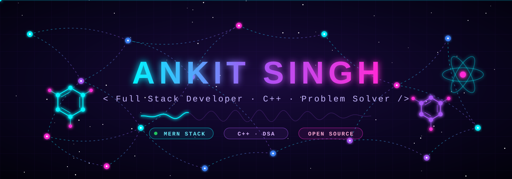
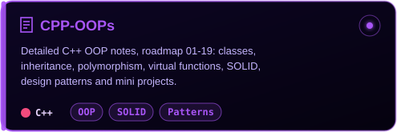
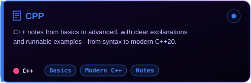
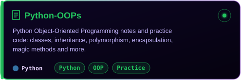

<!-- ═══════════════════════════  QUANTUM HEADER  ═══════════════════════════ -->
<p align="center">
  
</p>

<p align="center">
  <a href="https://github.com/mr-ankit-singh">
    
  </a>
</p>

<p align="center">
  
  <a href="https://github.com/mr-ankit-singh?tab=followers"></a>
  <a href="https://www.linkedin.com/in/mr-ankit-singh/"></a>
  <a href="mailto:mrankitsingh056@gmail.com"></a>
</p>


<!-- ═══════════════════════════  WHOAMI  ═══════════════════════════ -->
## ⚛️ `whoami`

<table>
<tr>
<td width="56%" valign="top">

**`ankit@quantum-node: ~`**

```bash
❯ whoami
Ankit Singh   # CSE student · builder · learner

❯ cat profile.json
```

```json
{
  "role"     : "Full Stack Developer",
  "focus"    : ["MERN", "AI / ML", "DSA"],
  "ai_stack" : ["LangChain", "FastAPI", "Python"],
  "web"      : ["React", "Node", "Express", "MongoDB"],
  "ask_me"   : ["JavaScript", "C++"],
  "status"   : "building AI-powered MERN apps 🚀"
}
```

```bash
❯ ./connect --open-to collaboration
● online — mrankitsingh056@gmail.com
```

</td>
<td width="44%" align="center" valign="middle">
  
</td>
</tr>
</table>

### 🛰️ Mission Log

<table>
<tr>
<td width="50%" valign="top">

**🚀 Building**
- AI-powered apps with **LangChain** + **FastAPI**
- Full-stack **MERN** projects

**🧠 Learning**
- LLM apps: chains, prompts, RAG basics
- Clean REST APIs with FastAPI & Express

</td>
<td width="50%" valign="top">

**📚 Writing**
- Deep, runnable notes on **C++ STL** & **OOP**
- From basics to design patterns & mini projects

**⚡ Practising**
- **DSA in C++** — arrays to graphs
- Problem solving, one node at a time

</td>
</tr>
<tr>
<td colspan="2" align="center">

💬 **Ask me about** JavaScript · C++ &nbsp;&nbsp;|&nbsp;&nbsp; 🤝 **Open to** collaboration & new tech &nbsp;&nbsp;|&nbsp;&nbsp; 📄 <a href="https://github.com/Resume.pdf" target="_blank"><b>Resume</b></a>

</td>
</tr>
</table>


<!-- ═══════════════════════════  TECH STACK  ═══════════════════════════ -->
## 🧪 Tech Stack — `the molecules I'm made of`

<table>
<tr>
<td align="center" width="150"><b>⚛️ Languages</b></td>
<td>
  &nbsp;&nbsp;
  &nbsp;&nbsp;
  &nbsp;&nbsp;
  &nbsp;&nbsp;
  &nbsp;&nbsp;
  
</td>
</tr>
<tr>
<td align="center"><b>🤖 AI / ML</b></td>
<td>
  &nbsp;&nbsp;
  &nbsp;&nbsp;
  &nbsp;&nbsp;
  &nbsp;&nbsp;
  
</td>
</tr>
<tr>
<td align="center"><b>🎨 Front-End</b></td>
<td>
  &nbsp;&nbsp;
  &nbsp;&nbsp;
  &nbsp;&nbsp;
  &nbsp;&nbsp;
  &nbsp;&nbsp;
  &nbsp;&nbsp;
  
</td>
</tr>
<tr>
<td align="center"><b>🛰️ Back-End</b></td>
<td>
  &nbsp;&nbsp;
  &nbsp;&nbsp;
  
</td>
</tr>
<tr>
<td align="center"><b>🧬 Databases</b></td>
<td>
  &nbsp;&nbsp;
  &nbsp;&nbsp;
  &nbsp;&nbsp;
  
</td>
</tr>
<tr>
<td align="center"><b>🔧 Tools</b></td>
<td>
  &nbsp;&nbsp;
  &nbsp;&nbsp;
  &nbsp;&nbsp;
  &nbsp;&nbsp;
  &nbsp;&nbsp;
  &nbsp;&nbsp;
  &nbsp;&nbsp;
  
</td>
</tr>
<tr>
<td align="center"><b>✨ Design</b></td>
<td>
  &nbsp;&nbsp;
  &nbsp;&nbsp;
  &nbsp;&nbsp;
  
</td>
</tr>
</table>


<!-- ═══════════════════════════  PROJECTS  ═══════════════════════════ -->
## 🔭 Featured Nodes — `repositories`

<p align="center">
  <a href="https://github.com/mr-ankit-singh/Standard-Template-Library-CPP"></a>
  <a href="https://github.com/mr-ankit-singh/CPP-OOPs"></a>
</p>
<p align="center">
  <a href="https://github.com/mr-ankit-singh/CPP"></a>
  <a href="https://github.com/mr-ankit-singh/AdventureAI"></a>
</p>
<p align="center">
  <a href="https://github.com/mr-ankit-singh/Python-OOPs"></a>
  <a href="https://github.com/mr-ankit-singh/JavaScript"></a>
</p>


<!-- ═══════════════════════════  STATS  ═══════════════════════════ -->
## 📡 Signal Strength — `GitHub analytics`

<p align="center">
  
  
</p>

<p align="center">
  
</p>

<p align="center">
  
</p>


<!-- ═══════════════════════════  CONNECT  ═══════════════════════════ -->
## 🤝 Establish Connection

<p align="center">
  <a href="https://www.linkedin.com/in/mr-ankit-singh/"></a>
  <a href="https://github.com/mr-ankit-singh"></a>
  <a href="mailto:mrankitsingh056@gmail.com"></a>
</p>

<p align="center">
  
</p>


