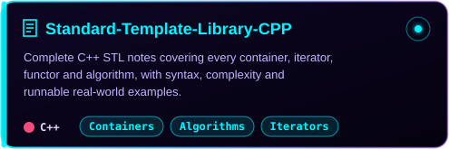
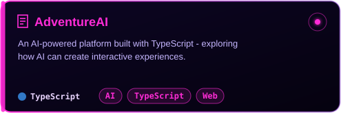
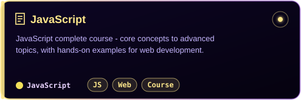

<!-- ═══════════════════════════  QUANTUM HEADER  ═══════════════════════════ -->

  

  
  
  
  

<!-- ═══════════════════════════  WHOAMI  ═══════════════════════════ -->
## ⚛️ `whoami`

  

  

  💬 <b>Ask me about</b> JavaScript · C++ &nbsp;&nbsp;•&nbsp;&nbsp; 🤝 <b>Open to</b> collaboration &amp; new tech &nbsp;&nbsp;•&nbsp;&nbsp; 📄 <a href="https://github.com/Resume.pdf" target="_blank"><b>Resume</b></a>

<!-- ═══════════════════════════  TECH STACK  ═══════════════════════════ -->
## 🧪 Tech Stack

  

<!-- ═══════════════════════════  PROJECTS  ═══════════════════════════ -->
## 🔭 Featured Nodes — `repositories`

  
  

  
  

  
  

<!-- ═══════════════════════════  STATS  ═══════════════════════════ -->
## 📡 Signal Strength — `GitHub analytics`

  
  

  

  

<!-- ═══════════════════════════  CONNECT  ═══════════════════════════ -->
## 🤝 Establish Connection

  
  
  

  

